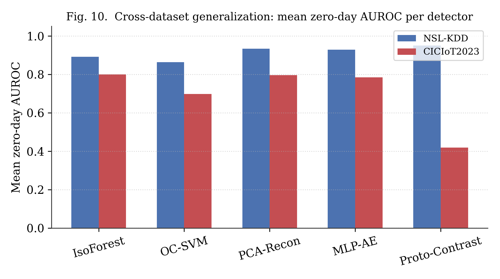

# Lightweight Open-Set Learning for Zero-Day Attack Detection in IoT Networks

Code, results and figures for a cross-dataset, compute-constrained benchmark of five CPU-only open-set detectors, evaluated on NSL-KDD and CICIoT2023 with a leave-attack-category-out protocol.

**Author:** Hilux Fokou Ngoumo, M.Sc. Information Security, Faculty of Secure Information Technologies, ITMO University, Saint Petersburg, Russia.
**Supervisor:** Prof. Sergey V. Bezzateev. **Working consultant:** Maxim Y. Fedosenko.

**Headline finding:** method rankings do not transfer across datasets. Prototype-Contrastive is best on NSL-KDD (mean unknown-AUROC 0.951) but worst on CICIoT2023 (0.419); Isolation Forest and PCA-Reconstruction stay strong on both.



## Repository layout
```
src/        data_prep.py, open_set_methods.py, evaluate.py, run_experiment.py
results/    results_nslkdd_dryrun.csv, results_ciciot2023.csv
figures/    all paper figures (PNG)
paper/      full manuscript (draft)
docs/       METHODOLOGY.md - how the research was carried out
data/       dataset download instructions (data not redistributed)
```

## Reproduce
```bash
pip install -r src/requirements.txt
# NSL-KDD (one held-out category per call; use --append to accumulate)
cd src
python run_experiment.py --dataset nslkdd \
  --nslkdd-train ../data/nslkdd/KDDTrain+.txt --nslkdd-test ../data/nslkdd/KDDTest+.txt \
  --out ../results/results_nslkdd_dryrun.csv --categories DoS --append
# CICIoT2023 (18% sample)
python run_experiment.py --dataset ciciot2023 --ciciot-dir ../data/ciciot2023/csv \
  --sample-frac 0.18 --out ../results/results_ciciot2023.csv --categories Web --append
```
Repeat with `--categories` set to each category. Full protocol, metrics and findings: [docs/METHODOLOGY.md](docs/METHODOLOGY.md). Dataset sources: [data/README.md](data/README.md).

## Citation
```
H. Fokou Ngoumo, "Lightweight Open-Set Learning for Zero-Day Attack Detection in IoT Networks:
A Cross-Dataset, Compute-Constrained Benchmark," 2026 (manuscript).
```

## License
MIT, see [LICENSE](LICENSE).
